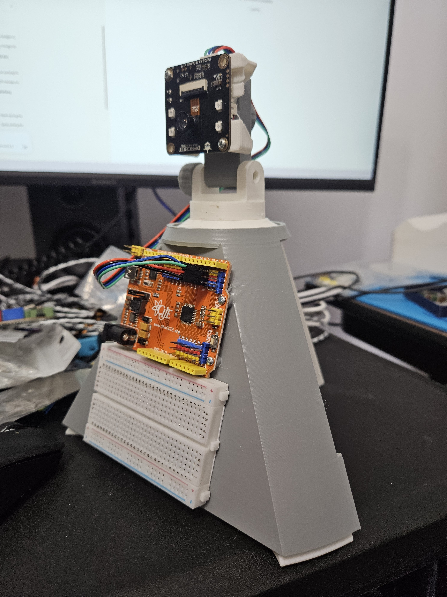
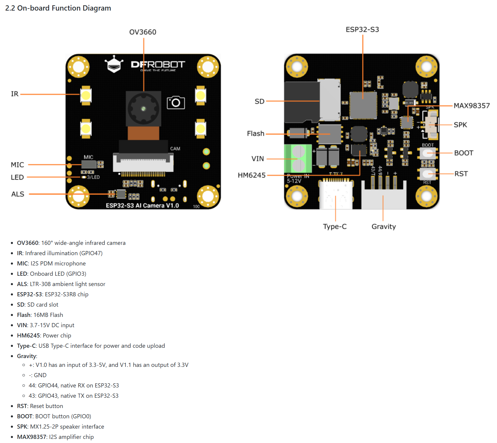

# Getting Started with the ESP32-S3 AI Camera

So you've got an ESP32-S3 AI CAM and you want to make it smart. This guide will walk you through everything step by step — no prior experience needed. If you can connect to WiFi and paste a key, you can do this.



---

## Official hardware (DFR1154)

This curriculum targets the **DFRobot ESP32-S3 AI CAM**, SKU **DFR1154**.

- **Product page (specs, purchase, shipping list):** [ESP32-S3 AI Camera Module — DFRobot](https://www.dfrobot.com/product-2899.html)
- **Wiki (pinout, tutorials, examples):** [DFR1154 documentation — DFRobot Wiki](https://wiki.dfrobot.com/dfr1154/)

**Further reading (different stack):** [DFRobot `openai-realtime-embedded-sdk`](https://github.com/DFRobot/openai-realtime-embedded-sdk) is an **ESP-IDF** project for OpenAI’s **Realtime API** on microcontrollers. It is *not* the same as the Arduino + browser web UI flow in this guide; use it only if you are exploring that separate development path.

### Pinout



Full GPIO-to-function table (camera data lines, mic, speaker amp, ALS, SD, LED/IR/BOOT): [`hardware/dfrobot_ai_camera_pin_designations.png`](hardware/dfrobot_ai_camera_pin_designations.png).

### Powering the board

Two independent options — pick based on whether the board is tethered to a computer or deployed standalone:

| Method | Spec | When to use |
|--------|------|--------------|
| **USB-C** | 5V (from computer or any USB power adapter/bank) | Programming (always required for flashing) and fine as the *only* power source for bench testing, development, or anything staying plugged into a computer/wall USB adapter. |
| **VIN screw terminal** (green 2-pin block, silkscreened **"Power IN 5-12V"**; datasheet lists 3.7–15V DC) | External DC supply (wall adapter, battery pack, solar + battery, etc.) | Standalone/deployed operation with **no USB connection** — e.g. the squirrel-deterrent camera mounted outdoors. `+` is the DC input, `-` is GND. |

You do **not** need the screw terminals if the board stays connected to a computer or a USB charger via USB-C — that alone powers it. Use the VIN terminals when it needs to run untethered.

> **Servos are a separate power domain.** The camera's VIN/USB power only runs the ESP32-S3, WiFi, camera, and SD card — it does **not** power any servos. In the [`edge_ml` squirrel-deterrent example](firmware/edge_ml/examples/squirrel_deterrent/), pan/spray servos live on the ACEBOTT + PCA9685, which needs its **own** external 5–6V supply on the PCA9685 `V+` terminal, with all grounds (camera, ACEBOTT, PCA9685, servo supply) tied common. See that example's [HOWTO.md](firmware/edge_ml/examples/squirrel_deterrent/HOWTO.md) for wiring.

---

## What You're Building

By the end of this guide, you'll have a camera that:
- Streams live video to your phone or laptop
- Takes photos and records audio
- Sends what it sees and hears to OpenAI (ChatGPT's brain) and gets a response
- Talks back to you with a speaker

All controlled from a web page on your browser. No app download needed.

---

## What You Need

| Item | Notes |
|------|-------|
| **ESP32-S3 AI CAM** | The DFRobot DFR1154 board specifically |
| **Micro SD card** | Any size works, 4GB+ is fine |
| **USB-C cable** | To connect the board to your computer (make sure it's a data cable, not charge-only) |
| **A computer with Chrome or Edge** | The flasher only works in these browsers |
| **WiFi network** | Your home WiFi — you'll need the name and password |
| **OpenAI API key** | We'll walk through how to get one below |

---

## Step 1: Get an OpenAI API Key

This is what lets the camera talk to ChatGPT's brain. You'll need a parent or guardian to help with this part since it requires a payment method.

1. Go to [https://platform.openai.com/signup](https://platform.openai.com/signup)
2. Create an account (or sign in if you already have one)
3. Go to [https://platform.openai.com/api-keys](https://platform.openai.com/api-keys)
4. Click **"Create new secret key"**
5. Give it a name like "AI Camera"
6. Copy the key — it starts with `sk-` and is a long string of characters
7. **Save it somewhere safe.** You can't see it again after you close the popup.

> **Heads up:** OpenAI charges a small amount per use (usually pennies per request). It's not free, but it's cheap. Ask a parent to set a monthly spending limit in the OpenAI dashboard under **Settings > Limits** so there are no surprises.

---

## Step 2: Flash the Firmware

This is the part where you load the camera software onto the board. No coding, no Arduino IDE, no installs — just your browser.

### Why a web flasher? (It is not “for the SD card”)

The program runs on the **ESP32-S3** chip. Firmware is written to the board’s **built-in flash memory** over **USB** using the browser (Chrome/Edge Web Serial). That is what the flasher is for.

The **microSD card** is separate: once firmware is running, the camera uses the card to **store photos, audio, and analysis files**. You should still **insert the SD card before flashing** so the board is ready when it reboots.

### Where students get the flasher

**Use a hosted flasher link** (from your instructor, school LMS, or curriculum site). That way learners do not need this repository, and you can update **firmware files** behind the same page when releases change.

### What we keep in this repo (maintainers)

| In [`web_flasher/`](web_flasher/) (stable — the “actual flasher”) | Firmware you flash (changes when you cut a new build) |
|-------------------------------------------------------------------|---------------------------------------------------------|
| Web flasher **page and tooling** (HTML, manifest, scripts, instructions) | Compiled **`.bin`** files (and related bootloader/partition blobs if your package needs them) |

You can **commit firmware binaries in git** when you want the repo to be self-contained, or **omit them** and only host them behind the class URL / a **GitHub Release** so the flasher UI in `web_flasher/` stays the same while you swap in new bins. Large binaries make clones heavier and diffs noisy; linking is lighter when you update often.

1. Make sure your **SD card is inserted** into the camera board
2. Plug the ESP32-S3 AI CAM into your computer with the **USB-C cable**
3. Open **Chrome** or **Edge** on your computer (other browsers won't work for this step)
4. Open the **flasher link** from your instructor or curriculum (not the SD card — this step programs the ESP32)
5. Click **"Flash Firmware"** (or the install button your hosted page shows)
6. A popup will ask you to pick a serial port — select the one that showed up when you plugged in the board
7. Wait for it to finish. You'll see a progress bar.

> **Nothing showing up when you click Flash?** Try a different USB cable — some cables only charge and can't transfer data. Also try holding the **BOOT** button on the board while clicking Flash, then let go after it starts.

---

## Step 3: Connect the Camera to Your WiFi

Once the firmware is flashed, the camera will restart automatically and create its own WiFi network.

1. On your phone or laptop, go to your WiFi settings
2. Look for a network called **AI-Camera-Setup**
3. Connect to it (there's no password)
4. A setup page should open automatically. If it doesn't, open a browser and go to `http://192.168.4.1`

You'll see a dark-themed setup page that looks like this:

5. Click **"Scan for Networks"** — your home WiFi networks will appear
6. Tap your WiFi network name
7. Type your WiFi password
8. Paste your **OpenAI API key** from Step 1 into the API key field
9. Click **"Connect & Start Camera"**

The camera will try to connect. If it works, you'll see a success message with an IP address like `192.168.1.42`. The camera will restart on its own.

> **Connection failed?** Double-check your WiFi password. The most common mistake is a typo. Click Scan again and try once more.

---

## Step 4: Open the Camera Interface

1. Make sure your phone or computer is back on your **home WiFi** (not "AI-Camera-Setup" anymore)
2. Open any browser (Chrome, Safari, Firefox, whatever)
3. Type the IP address from Step 3 into the address bar: `http://192.168.1.42` (use your actual IP)
4. Hit Enter

You should see the camera interface load up:


That's it. You're in.

---

## Using the Camera

Here's what all the buttons do:

### Video
- **Video Stream** — Starts/stops the live video feed
- **Capture** — Takes a photo and saves it to the SD card
- **Review** — Shows the last photo you took

### Audio
- **Record** — Records audio from the microphone (5 seconds by default)
- **Speaker** — Plays back audio through the speaker

### Files
- Each image and audio file shows up in a list on the right
- **Add to Export** — Queues a file to send to OpenAI
- **Save to PC** — Downloads the file to your computer
- **Delete File** — Removes it from the SD card

### AI Analysis
1. Capture a photo (or a few — you can send up to 5 at once)
2. Click **Add to Export** on the images you want analyzed
3. Record audio and click **Add to Export** on the audio file too
4. Click **Send to OpenAI**
5. Wait about 60-90 seconds — you'll see a progress bar
6. The AI's response will appear in the message box at the bottom
7. Click **Replay TTS** to hear the response spoken out loud

---

## Troubleshooting

| Problem | Fix |
|---------|-----|
| Can't find "AI-Camera-Setup" WiFi | Make sure the firmware flashed successfully. Try unplugging and replugging the board. |
| Setup page won't load | Try going to `http://192.168.4.1` manually in your browser. |
| WiFi won't connect | Double-check your WiFi password. Make sure there are no extra spaces. |
| "SD Card FAIL" in serial monitor | Make sure an SD card is inserted. Try formatting it as FAT32. |
| Can't open the camera web page | Make sure your device is on the same WiFi as the camera. Use `http://` not `https://`. |
| OpenAI analysis fails | Check that your API key is correct and has credits loaded. |
| Want to start completely over | Hold the **BOOT** button on the board for 3 seconds. This factory resets the camera back to the setup screen. |

---

## What's on the SD Card

The camera organizes everything into folders:

```
/images/       — All captured photos (JPEG)
/audio/        — All recorded audio (WAV)
/tts/          — Text-to-speech audio responses (MP3)
/analysis/     — AI analysis results, organized by timestamp
```

The optional **edge ML** example sketch may also write **`/triggers/`** (JPEG snapshots when a spray event runs). See below.

---

## Edge ML (on-device inference)

For projects that need **fast, on-board** vision (no cloud round trip), this repo includes an Arduino library under **[`firmware/edge_ml/`](firmware/edge_ml/)**.

- **Camera + SD pins** match the DFR1154 layout used in **`ESP32_AI_Camera_v3_2_5`** (same JPEG / SVGA defaults).
- **`edge_ml_api`** is a small hook for **TensorFlow Lite / Edge Impulse** style models; the default build ships a **stub** so sketches compile until you drop in a trained model.
- **Optional HTTP** **`/dash`** (calibration + arm/disarm + live status), **`/stream`**, and **`/capture`** so you can aim the camera and tune NVS-backed settings over WiFi (same `/stream` polling pattern as the main firmware).
- **Example:** [`firmware/edge_ml/examples/squirrel_deterrent/`](firmware/edge_ml/examples/squirrel_deterrent/) — reference pan/spray logic, SD trigger photos, and a **HOWTO** for wiring and Edge Impulse.
- **Board settings:** same DFR1154 hardware as the standalone firmware, so use the same board settings table [above](#for-advanced-users--instructors).

Full toolchain notes, Impulse integration outline, and camera/HTTP sharing rules: **[`firmware/edge_ml/README.md`](firmware/edge_ml/README.md)**.

---

## For Advanced Users / Instructors

If you want to skip the web flasher and use Arduino IDE instead:

1. Open `firmware/standalone/ai_camera_unified_3.0.0/ai_camera_unified_3.0.0.ino` in Arduino IDE (or the sketch folder for the version you are shipping)
2. Install the **ArduinoJson** library (Tools > Manage Libraries)
3. Board settings — these apply to **every sketch in this repo** (standalone firmware and the `edge_ml` examples alike), since they're all the same DFR1154 ESP32-S3 board:

   | Setting | Value |
   |---------|-------|
   | Board | **ESP32S3 Dev Module** |
   | USB CDC On Boot | **Enabled** |
   | CPU Frequency | **240MHz (WiFi)** |
   | Core Debug Level | **None** |
   | USB DFU On Boot | **Disabled** |
   | Erase All Flash Before Sketch Upload | **Disabled** |
   | Events Run On | **Core 1** |
   | Flash Mode | **QIO 80MHz** |
   | Flash Size | **16MB (128Mb)** |
   | JTAG Adapter | **Disabled** |
   | Arduino Runs On | **Core 1** |
   | USB Firmware MSC On Boot | **Disabled** |
   | Partition Scheme | **16M Flash (3MB APP/9.9MB FATFS)** |
   | PSRAM | **OPI PSRAM** |
   | Upload Mode | **UART0 / Hardware CDC** |
   | Upload Speed | **921600** |
   | USB Mode | **Hardware CDC and JTAG** |
   | Zigbee Mode | **Disabled** |

   

4. Upload. The setup portal will handle WiFi and API key configuration — no code editing needed.

To build binaries for the hosted web flasher: use **Sketch > Export Compiled Binary** in Arduino IDE, then place the exported `.bin` files (and matching bootloader/partitions if your package uses them) into the appropriate folder under [`web_flasher/`](web_flasher/) following the README inside that package, or upload them to the hosting location your class link uses.

---

That's it. You've got a working AI camera. Take some photos, ask the AI what it sees, and start experimenting.
